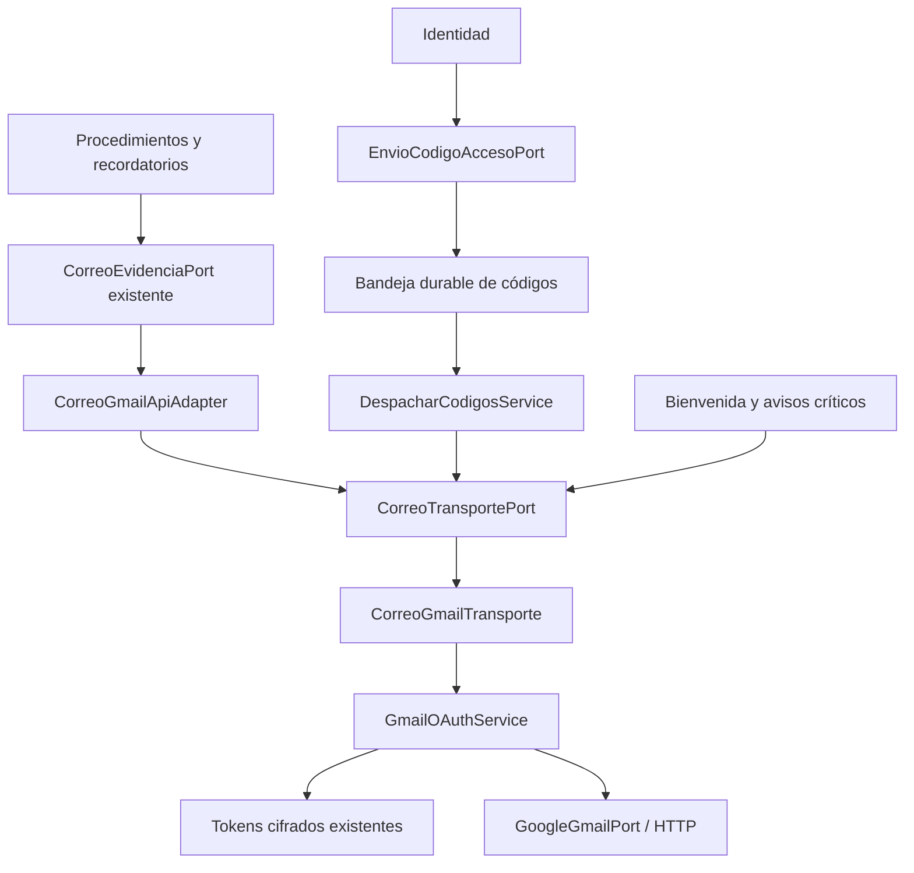

# Correo central y acceso mediante códigos

Fecha: 2026-11-10. Implementación local sobre `f823d61`, sin commit, despliegue, ejecución de SQL ni alteración de secretos/cuenta OAuth. Los cambios locales anteriores se conservan.

## Comportamiento

- Todos los roles de cuentas registradas, activas y con rol activo ingresan por código. Se admiten correos institucionales y personales. No hay registro público.
- `POST /api/auth/codigo` devuelve HTTP 202 y el mismo mensaje/modo/tiempos para cuentas existentes, inexistentes, inactivas o limitadas por cuenta. Es recepción de solicitud, no confirmación de envío.
- `POST /api/auth/codigo/verificar` devuelve JWT solo después de validar y consumir el código. Ausente, inactivo, vencido, consumido o bloqueado produce el mismo error de código inválido.
- `/api/auth/login`, `/api/auth/recuperar/codigo` y `/api/auth/recuperar/password` responden 410 para solicitudes válidas. No se eliminan contratos ni columnas. `/api/auth/recuperar/email` es un alias de la solicitud de ingreso. Angular redirige `/recuperar` a `/login`.
- Se conservan los hashes históricos. Crear usuarios ya no exige contraseña y genera un hash aleatorio no entregado al usuario para satisfacer el esquema existente. La API administrativa de modificación de hashes se mantiene por compatibilidad; esos hashes no habilitan login público.
- Generación con SecureRandom, hash BCrypt, cinco minutos de vigencia por defecto, cinco verificaciones fallidas por código. El comparador ya no acepta hashes en texto plano.
- Un reenvío admitido invalida todos los códigos anteriores, incluidos los de operaciones antiguas. Un reenvío limitado conserva el código vigente. El bloqueo pesimista de la fila del usuario serializa emisión y consumo en la BD, incluso entre instancias.

## Arquitectura y preservación de Procedimientos

En Ejecuciones solo cambia la dependencia del adaptador Gmail: usa el puerto central. No se modifican reglas, MIME, destinatarios, reservas, registros, referencias, eventos AFTER_COMMIT ni seguimiento. No se cambia `dimabug.automatizacion.modo`.

El envío normal de evidencias conserva su invalidación OAuth histórica. Los códigos, bienvenidas y avisos utilizan la operación protegida: un rechazo de autorización no borra tokens ni marca la cuenta compartida desde esos consumidores. La renovación válida de tokens sigue siendo compartida y sincronizada. Una revocación real en Google, una cuota o una caída del proveedor afectan físicamente a la cuenta compartida; no existe aislamiento total sin cuentas distintas.

Bienvenidas y avisos críticos usan el mismo transporte y conservan su despacho posterior al commit y plantillas. Su ejecución sigue en memoria, como antes; la durabilidad incorporada en esta entrega corresponde a los códigos de acceso.

La renovación y el envío con tokens existentes ya no requieren URLs válidas del panel OAuth. Iniciar/completar una autorización sí exige callback y frontend válidos. Se mantienen las credenciales OAuth y la clave original como requisitos de transporte.

## Bandeja y seguridad de envío

`u_correo_codigo` contiene una fila única por código, identificador UUID interno, contenido MIME cifrado AES-GCM con contexto propio, expiración, estado, intentos y referencia de Gmail. La tabla de códigos conserva solamente el hash. No se registran códigos, contenido MIME ni tokens en los logs del nuevo flujo.

El worker consulta únicamente filas confirmadas, reserva en una transacción corta y ejecuta la llamada de red fuera de transacción. Tiene scheduler propio; el seguimiento conserva un scheduler separado de un hilo. La reserva bloqueada evita que dos instancias despachen simultáneamente la misma fila.

| Estado | Tratamiento |
|---|---|
| PENDIENTE | Espera despacho |
| ENVIANDO | Reserva por hasta 60 segundos |
| ENVIADO | Gmail aceptó y devolvió referencia; no garantiza llegada al buzón |
| ERROR_TEMPORAL | Conectividad durante renovación OAuth o conflicto previo al envío; máximo tres intentos, esperas de 20 y 40 segundos |
| ERROR_PERMANENTE | Rechazo explícito o agotamiento de intentos |
| NO_CONFIGURADO | Falta configuración/cifrado; requiere corrección operativa y nueva solicitud |
| REAUTORIZAR | Google rechazó la autorización; no se borran los tokens desde autenticación |
| INCIERTO | Resultado no confirmado o reserva abandonada: no se reenvía automáticamente |
| EXPIRADO | Código caducado, consumido, invalidado o bloqueado antes del despacho |

El cifrado se elimina al terminar; si queda una fila pendiente o abandonada, se limpia al detectar expiración. Un resultado incierto no ofrece garantía de exactamente una entrega: Gmail no proporciona aquí una clave de idempotencia del cliente. La aplicación evita repetir esos envíos a ciegas.

Los registros de resultados no se purgan automáticamente. Definir retención operativa de metadatos antes de producción. No incluir contenido cifrado ni hashes en paneles públicos o volcados de soporte.

## Configuración

No se genera ni rota automáticamente ninguna clave. Debe recuperarse la clave original capaz de descifrar los tokens existentes; una nueva clave hace inutilizables esos cifrados.

| Propiedad / variable | Uso |
|---|---|
| `GOOGLE_CLIENT_ID`, `GOOGLE_CLIENT_SECRET` | Cliente OAuth, separados por entorno |
| `GMAIL_TOKEN_ENCRYPTION_KEY` | Clave original Base64 de 32 bytes para tokens y contenido temporal |
| `GMAIL_SENDER_EMAIL` | Remitente de la cuenta autorizada |
| `GMAIL_OAUTH_HABILITADO`, `GMAIL_ENVIO_REAL_HABILITADO` | Habilitación explícita; defaults del perfil staging corregidos a false |
| `GMAIL_OAUTH_REDIRECT_URI`, `GMAIL_FRONTEND_URL` | Autorización administrativa; URLs HTTPS válidas salvo localhost |
| `JWT_SECRET`, `JWT_EXPIRATION` | Obligatorios, sin secretos predeterminados |
| `dimabug.auth.codigo.minutos-vigencia` | 5 por defecto |
| `dimabug.auth.codigo.segundos-reenvio` | 60 por defecto |
| `dimabug.auth.codigo.maximo-15-minutos` | 5 emisiones por cuenta |
| `dimabug.auth.codigo.maximo-dia` | 20 emisiones por cuenta |
| `dimabug.auth.limite-ip-minuto` | 20 POST de autenticación por IP y minuto, por instancia |
| `dimabug.auth.correo.intervalo-ms` | 10000 por defecto |
| `dimabug.auth.correo.maximo-minuto` | 10 intentos de despacho por minuto e instancia; presupuesto separado de evidencias |

Las propiedades antiguas `usar-gmail-api` y `mostrar-en-log` ya no controlan autenticación. No hay alternativa SMTP ni impresión de códigos aunque una configuración externa todavía las declare. El perfil SMTP se conserva para el transporte histórico explícito de Procedimientos; no se cambia su modo.

El filtro tiene memoria acotada, límite global local de 300 POST/minuto, máximo de 4096 IP y cuerpo máximo de 4096 bytes. Ignora X-Forwarded-For del cliente. Detrás de proxy, configurar por separado una identidad de IP confiable y límites en el borde; no asumir que el límite local cubre un despliegue distribuido. Los límites por cuenta se calculan en BD bajo bloqueo. Probar capacidad: con diez envíos/minuto una cola extensa puede caducar antes de ser despachada.

**La contraseña SMTP potencialmente expuesta se considera comprometida: el responsable debe revocarla y rotarla.** No se ha hecho en esta entrega por la prohibición de modificar credenciales. No se reutiliza en autenticación.

## Despliegue futuro: cambios separados y autorizados

1. Respaldar configuración efectiva y artefactos anteriores mediante la custodia habitual, sin imprimir secretos. Inventariar perfiles/overrides y verificar la rotación SMTP.
2. Verificar una contingencia administrativa fuera del correo antes de retirar el ingreso por contraseña en el servidor. Esta entrega no añade una puerta de emergencia pública. Si no hay recuperación probada, no promover.
3. DBA revisa y aplica **solo con autorización de despliegue** `docs/04_Base_Datos/V20261110_01__correo_codigo.sql`. Es una expansión de tabla nueva; no altera usuarios, códigos o OAuth. No usar Hibernate create/update sobre una BD existente. El repositorio no tiene runner automático de migraciones.
4. Verificar la configuración y la clave existentes sin revelar valores. Mantener el modo actual de Procedimientos y declarar flags de correo explícitamente. No revocar/reautorizar una cuenta ACTIVA como parte rutinaria de la instalación.
5. Publicar backend y frontend coordinadamente en una ventana autorizada. Los clientes antiguos de password recibirán 410. La nueva tabla debe existir antes de iniciar el backend.
6. Ejecutar smoke tests autorizados por rol y dominio y regresión de evidencias. Una prueba real de correo requiere autorización separada y destinatario controlado. Verificar MySQL 8 real, proxy, TLS y cuotas: H2 no certifica ese entorno.
7. Observar metadatos de cola y errores sanitizados. No presentar 202 como prueba de entrega.

## Reversión

Restaurar backend/frontend y configuración anterior aprobados, sin borrar la tabla nueva, los hashes ni la cuenta OAuth. Detener el consumo de la nueva cola mediante la retirada del artefacto, no reproducir filas ENVIANDO/INCIERTO. Esperar la caducidad de los códigos emitidos durante la transición. Comprobar acceso de un administrador existente con el método de la versión anterior; las cuentas nuevas tienen hashes aleatorios, no contraseñas conocidas. La reversión exige planificar ese acceso de antemano.

No hay SQL de borrado ni reversión destructiva. Eliminar columnas/endpoints definitivamente queda para otra migración y compatibilidad aprobadas.

## Validación local

Pruebas de autenticación, cola, límites, transporte/OAuth y regresiones de Procedimientos usan H2 en memoria, mocks o MockRestServiceServer. La prueba de integración nueva verifica explícitamente la URL H2 antes de preparar datos y sustituye GmailOAuthService para impedir llamadas reales.

La suite cubre roles, dominios personales/institucionales, respuesta uniforme, hash/caducidad, intentos, concurrencia de emisión y consumo, rollback sin despacho, JWT, cifrado y limpieza de contenido, errores, recuperación de reservas, reintentos acotados, preservación de tokens y evidencias.

Resultados finales y comandos reproducibles: `docs/07_Pruebas/QA_correo_central_2026-11-10.md`.

## Archivos principales

- Correo: `CorreoTransportePort`, `CorreoGmailTransporte`, `GmailOAuthService`, `GmailSettings`, `GmailConfig`, `GoogleGmailHttp`.
- Identidad: `AutenticarUsuarioService`, `EnvioCodigoAccesoPort`, `EnvioCodigoAccesoCorreoAdapter`, `CorreoCodigoStore`, `CorreoCodigoStoreJpa`, `CorreoCodigoEntity`, `DespacharCodigosService`, `CorreoCodigoSchedulingConfig`, repositorio de códigos, validación BCrypt y DTOs/controlador.
- Notificaciones: adaptadores de bienvenida y ticket crítico detrás del puerto central; plantillas conservadas.
- Seguridad: `LimiteAutenticacionFilter`.
- Procedimientos: únicamente `CorreoGmailApiAdapter` detrás del puerto común.
- Angular: login, cliente de autenticación, redirección de recuperación y formulario de usuarios.
- Configuración: perfiles example y staging; SQL aditivo y esta documentación.
- QA: casos nuevos de cola/límites/aislamiento/notificaciones y adaptación de contratos/fixtures existentes, conservando sus cambios locales previos.
