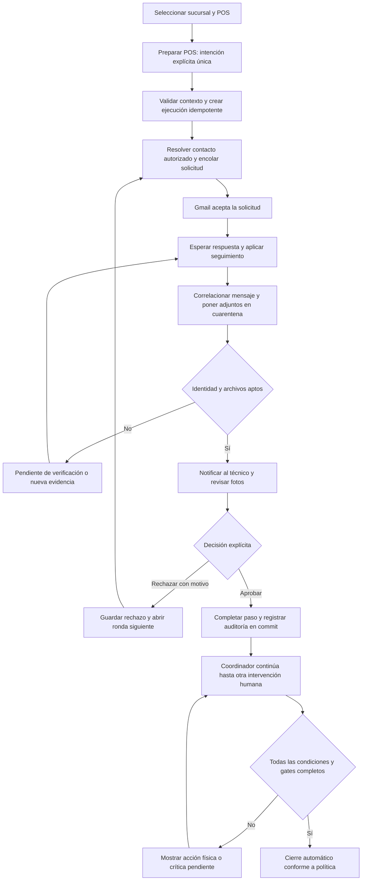
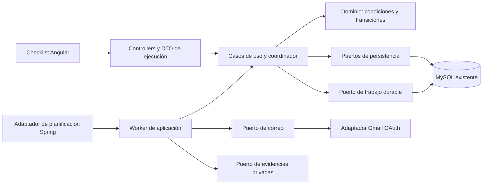

# DimaBug: procedimientos semiautomatizados y evidencias por Gmail

Fecha: 7 de noviembre de 2026, America/Santiago.

**Estado: propuesta para revisión, NO implementada ni aprobada.** Se realizaron lecturas del repositorio y consultas a documentación oficial. Solo se crean esta propuesta, el backlog y su registro de evidencia. No se modifican aplicación, configuración, dependencias, SQL, documentación vigente o paquete académico. No se conectan buzones o bases, no se crean issues y no se envían correos.

## 1. Decisión recomendada

Evolucionar los agregados existentes Procedimiento/Paso y Ejecución/EjecuciónPaso, conservando su arquitectura y sus contratos manuales. Añadir un coordinador de transiciones por condiciones verificadas, una solicitud de evidencias asociada a la **instancia del paso**, integración Gmail mediante un buzón dedicado autorizado y trabajos durables en MySQL.

**MVP propuesto:** OAuth de usuario sobre un único buzón corporativo dedicado, `gmail.send` + `gmail.readonly`, consulta incremental periódica, programación Spring con persistencia de trabajos, fotos en almacenamiento privado y aprobación explícita del técnico autorizado. Los pasos nuevos se habilitan después del commit; no se necesita volver a marcar «hecho» ni pulsar «siguiente». Pub/Sub queda como mejora posterior.

El mínimo permiso para leer respuestas y adjuntos sigue siendo amplio respecto de ese buzón: una búsqueda o etiqueta limita qué procesa el programa, **no** reduce el alcance de autorización a una conversación. El buzón dedicado es una medida de minimización, no un permiso para leer todos los buzones de la organización. [Scopes oficiales de Gmail](https://developers.google.com/workspace/gmail/api/auth/scopes).

La recepción de correo, tres imágenes, un timeout o un envío aceptado por Gmail nunca acreditan por sí solos una instalación, suministro eléctrico seguro o carga de folios. La automatización prepara, relaciona, recuerda y actualiza estados; la validación humana conserva las decisiones físicas/críticas.

### Clasificación global

| Propuesta | Clasificación | Motivo |
|---|---|---|
| Reutilizar las cuatro entidades y servicios de ejecución | Imprescindible | Evitar un segundo motor de progreso incompatible |
| Condiciones de finalización, autorización y control de concurrencia en backend | Imprescindible | Impedir avance por un PATCH o evento no autorizado |
| Directorio de sucursales y responsables validado | Imprescindible | No se puede inventar el jefe/correo desde el texto del procedimiento |
| Buzón dedicado + OAuth autorizado, sin contraseñas | Imprescindible | Acceso acotado y operación desatendida controlada |
| Correlación, deduplicación, outbox y auditoría durables | Imprescindible | Reinicios/reintentos no deben repetir acciones ni perder decisiones |
| Evidencia privada, cuarentena y revisión de identidad/archivos | Imprescindible | El remitente y los adjuntos son entradas no confiables |
| Aprobación crítica y avance posterior al commit | Imprescindible | Preservar seguridad y reducir acciones redundantes |
| Recordatorios configurables y cancelación de pendientes | Imprescindible | Requerimiento operativo explícito |
| Confirmación de identidad corporativa mediante Google OIDC | Imprescindible para el piloto seguro propuesto | No convertir From o un enlace reenviado en prueba de identidad |
| Autosave de observaciones y lectura periódica de progreso | Recomendable | Reducir guardados sin afirmar progreso no confirmado |
| Pub/Sub con watch y sincronización de respaldo | Opcional al inicio | Menor latencia a cambio de infraestructura adicional |
| Directorio Workspace automático | Opcional | El origen maestro y permisos no están confirmados; comenzar con catálogo autorizado |
| Agente del POS y comprobaciones de instalación | Opcional y fuera del MVP | Requiere contrato técnico/seguridad del equipo y proveedores |
| Motor BPMN, Kafka, Quartz o microservicio nuevo | No recomendado para este MVP | No hay necesidad demostrada que justifique esa infraestructura |

## 2. Diagnóstico del módulo actual

La revisión vuelve a leer las fuentes actuales; las guías anteriores son antecedentes. Los paths y ubicaciones se registran en `EVIDENCIA_REVISION.json`.

### 2.1. Persistencia y definición

| Elemento comprobado | Implementación actual | Límite relevante |
|---|---|---|
| `pr_procedimiento` / ProcedimientoEntity | Nombre, descripción, BORRADOR/PUBLICADO, autores/fechas | No configuración de automatización o sucursal |
| `pr_paso` / PasoEntity | Procedimiento ID, orden, instrucción, boolean `esCritico`; UNIQUE declarado por padre/orden | No modo de ejecución, condición, evidencia o dependencia ejecutable |
| `se_ejecucion` / EjecucionEntity | Procedimiento ID, usuario, fechas, estado y observaciones | No contexto de sucursal/POS ni clave idempotente de inicio |
| `se_ejecucion_paso` / EjecucionPasoEntity | Ejecución/paso, `cumplido`, observación y fecha; UNIQUE declarado por pareja | Booleano no expresa espera, evidencia, rechazo o error; no snapshot/versionado |
| `co_material_apoyo` | Material de definición enlazado a conocimiento o paso | No identifica ejecución/solicitud; no usarlo como repositorio de fotos operativas |
| Organización existente | Departamentos, contactos y responsables | No se encontró un directorio con semántica de sucursal y jefe de tienda |

No se consultó MySQL. Las restricciones mencionadas son mapeos/contratos, no certificación del esquema instalado.

El título «Preparar POS Toshiba para las ventas de Dimarsa y Dimarket» y los seis pasos descritos por la usuaria **no aparecen en código o fixtures revisados**. Se toman como caso de negocio proporcionado, no como filas verificadas de BD. Su ID, contenido vigente y estado deben confirmarse en una actividad autorizada antes de configurar el piloto.

### 2.2. Flujo backend real

`GestionarEjecucionService.iniciar` comprueba que el procedimiento sea PUBLICADO y tenga pasos; crea cabecera EN_CURSO y checklist no cumplido dentro de una transacción. El actor procede del email autenticado. Consultas y cambios autorizan propietario o administrador.

`actualizarPaso` comprueba EN_CURSO y pertenencia del paso. Acepta `Boolean cumplido` y observación; un boolean nulo conserva el cumplimiento actual. Al marcar registra fecha; al desmarcar la borra. **No comprueba evidencia, identidad de tercero, predecesores ni autorización crítica diferenciada.**

`completar` exige que no existan pasos pendientes. `cancelar` cierra sin exigir cumplimiento y conserva motivo. El repositorio de ejecución usa lecturas normales, sin bloqueo de cabecera o @Version encontrado. Antes de ampliar automatización hay que cubrir cierre/actualización y otros intercalados; @Transactional por sí solo no resuelve lectura obsoleta.

`listarPasos` consulta las instrucciones actuales de `pr_paso`. No hay snapshot capturado por ejecución en este árbol, aunque una decisión histórica lo describía. La inmutabilidad de PUBLICADOS está protegida por `EdicionProcedimiento` y servicios; debe conservarse.

### 2.3. Endpoints actuales reutilizables

| Método | Ruta existente | Función |
|---|---|---|
| POST | `/api/procedimientos/{procedimientoId}/ejecuciones` | Inicio, sin body de contexto en contrato actual |
| GET | `/api/ejecuciones` | Listado por actor, administrador puede ver todas |
| GET | `/api/ejecuciones/{id}` | Cabecera autorizada |
| GET | `/api/ejecuciones/{id}/pasos` | Checklist con definición actual |
| PATCH | `/api/ejecuciones/{id}/pasos/{ejecucionPasoId}` | Cumplimiento/observación |
| PATCH | `/api/ejecuciones/{id}/completar` | Cierre con todos cumplidos |
| PATCH | `/api/ejecuciones/{id}/cancelar` | Cancelación |
| GET/POST/PUT | `/api/procedimientos/{id}/pasos[...]` | Definición de pasos bajo sus permisos |

Estos contratos no se cambiaron. Las rutas nuevas de la sección 9 son propuestas, no endpoints existentes.

### 2.4. Frontend y UX comprobados

`ProcedimientoDetalleComponent.iniciar` llama al servicio y navega al checklist. `EjecucionChecklistComponent` muestra progreso, pasos críticos, observaciones y cierre. Ya existe `avanzarAlPendiente`: no corresponde proponer un botón Siguiente obligatorio como si no hubiera avance automático.

Problemas y mejoras concretas:

| Hallazgo fuente | Consecuencia | Cambio propuesto | Clasificación |
|---|---|---|---|
| `marcar` actualiza lista/caché y avanza **antes** de la respuesta HTTP | Puede mostrar el siguiente paso aunque falle el guardado; el error restaura lista pero no garantiza foco/paso anterior | Avanzar solo al confirmar transición servidor; un indicador de envío no equivale a cumplimiento | Imprescindible |
| `esCritico` controla advertencia y estilo, mismo botón de marcar | No hay aprobación/evidencia adicional en backend | Acción crítica explícita asociada al conjunto de evidencias y versión | Imprescindible |
| Navegación lateral/Anterior/Siguiente permite recorrer pasos | Ver un paso no implica que esté habilitado para ejecutarlo | Mantener lectura libre, bloquear comandos si faltan precondiciones en servidor | Imprescindible |
| Botón Guardar observación y PATCH que incluye `cumplido` local | Acción adicional y riesgo de reenviar estado viejo al guardar texto | Autosave de solo observación, debounce/blur, estado visible y control de versión | Recomendable |
| Caches localStorage/shareReplay y contadores locales de versión | No sustituyen versión backend ni sincronización de cambios externos | GET forzado al refrescar; polling con cursor/version, pausa por visibilidad y al cerrar | Imprescindible para mostrar eventos externos |
| Cola `seguirPasos` del servicio Angular | Precarga consultas; no es un planificador backend ni un polling periódico de Gmail | No reutilizarla para recordatorios durables | Imprescindible |
| Inicio y cierre manuales independientes | Clics reducibles si ya hay intención y condiciones suficientes | Una acción inicial «Preparar POS» con contexto; cierre automático solo con todas las condiciones/gates satisfechas | Recomendable |
| Confirmación de cancelación y aviso de datos sin guardar | Previene pérdida o cancelación accidental | Conservar; no eliminar por reducir clics | Imprescindible |

La experiencia no se midió en navegador o UAT en esta revisión. Un escenario **hipotético** de seis pasos marcados manualmente requiere al menos inicio + seis marcas + cierre, ocho acciones de cambio de estado; no es una medición real de clics y no suma Siguiente que ya puede ser automático. El beneficio debe medirse contra una línea base observada.

### 2.5. Seguridad, pruebas y reutilización

Spring Security utiliza JWT/BCrypt, sesiones STATELESS y roles A/T/S/U. Ejecuciones operacionales admiten A/T/S por la cadena y propietario/admin por aplicación. Los guards Angular siguen siendo navegación, no autorización definitiva. Gmail OAuth y Google OIDC requieren validadores distintos del JWT HMAC propio de DimaBug.

Se reutilizan servicios, DTO, dominio y tablas base; el patrón de puertos/adaptadores; validación de archivos por firma/tamaño; componentes de carga/errores y guard de salida; infraestructura JUnit/Mockito/MockMvc y Jasmine/Karma. El almacenamiento actual está ligado a materiales: reutilizar sus validadores, **no** asignar fotos de ejecución como materiales globales ni abrir un directorio públicamente.

Pruebas encontradas: `GestionarEjecucionServiceTest` (22 escenarios en el reporte del 06-11-2026), `MantenerPasoServiceTest` (12), `MantenerProcedimientoServiceTest` (8), `Hu06SecurityIntegrationTest` (7), `Hu07SecurityIntegrationTest` (14), más suites de materiales y specs de edición/recuperación de procedimientos. No se encontró un spec dedicado al nuevo checklist de ejecución. No se encontraron pruebas Gmail, recordatorios, OIDC externo o gate de evidencia.

Los 920 backend/284 Angular aprobados corresponden a la auditoría del día anterior. No se repitieron aquí y no prueban esta evolución todavía inexistente. No se encontró `@Scheduled`, `@EnableScheduling`, Quartz, TaskScheduler propio, Gmail o modelo Sucursal en las fuentes funcionales revisadas.

## 3. Reparto de automatización en el caso Toshiba

| Actividad proporcionada | Qué puede hacer DimaBug | Evidencia/condición mínima propuesta | Intervención humana conservada | Clasificación |
|---|---|---|---|---|
| 1. Mueble, red y electricidad | Resolver contacto autorizado, solicitar fotos, correlacionar respuesta, revisar archivos, recordar, mostrar evidencia | Cobertura de las tres categorías, archivos seguros, identidad vinculada y aprobación autorizada de la ronda vigente | Jefe aporta fotos y confirma identidad; técnico revisa suficiencia. Una foto no certifica funcionalidad eléctrica/de red | Imprescindible, VALIDACION_EXTERNA + crítica |
| 2. Boot USB Debian 12 | Presentar instrucciones/contexto y registrar resultado | Confirmación técnica explícita o futura telemetría confiable del equipo | Inserción/boot físicos y comprobación de sistema quedan manuales en MVP | Imprescindible mantener MANUAL; criticidad a confirmar |
| 3. Comandos de terminal | Preparar instrucciones aprobadas y recoger resultado | Comandos, privilegios y resultados esperados aprobados; atestación verificable si en futuro existe agente | No hay agente, SSH o canal de ejecución probado. No ejecutar shell arbitrario enviado por email | Manual en MVP; integración opcional posterior |
| 4. Instalar Comercial | Guiar y registrar validación | Versión/origen del paquete y prueba de funcionamiento definida por dueño | Instalación/verificación técnica hasta disponer de integración comprobada | Manual en MVP |
| 5. Instalar Transbank | Guiar y registrar checklist autorizado | Validación de funcionamiento acordada con proveedor, sin datos sensibles de pago en evidencia | Técnico conserva aprobación; no inferir éxito por tiempo o correo | Manual y propuesta crítica, política a aprobar |
| 6. Avisar Control Cajas y solicitar folios | Enviar comunicación al destinatario maestro autorizado y seguir respuesta | Distinguir solicitud aceptada por proveedor de **folios realmente cargados** | Si el objetivo requiere folios cargados, Control Cajas aporta prueba y técnico valida o una futura API confiable lo demuestra | Envío AUTOMATICO; validación externa crítica si se aprueba ampliación semántica |

No convertir los seis pasos en AUTOMATICO. Para paso 6, el texto original solicita una carga; no demuestra que incluya verificarla. La definición nueva debe decidir si completa «solicitud emitida» o «folios confirmados». No declarar «POS listo para ventas» con folios o pruebas funcionales pendientes. Comandos, instaladores, pruebas y política Transbank quedan [PENDIENTE DE VERIFICACIÓN].

## 4. Modelo de pasos y estados propuesto

### 4.1. Modo y criticidad, dos dimensiones

Reutilizar `esCritico`; no añadir CRITICO como un quinto valor excluyente. Proponer `modoEjecucion` con MANUAL, AUTOMATICO, VALIDACION_EXTERNA e INFORMATIVO. Ejemplo: VALIDACION_EXTERNA y `esCritico=true`. Un paso AUTOMATICO crítico puede ejecutar una operación, pero debe esperar la aprobación definida antes de continuar.

La configuración solo referencia acciones de un registro de handlers permitido y esquemas de parámetros validados. No contiene SQL, shell, clases Java, URLs de callbacks arbitrarias o destinatarios recibidos sin verificar. Versión de configuración y política capturadas al inicio para impedir que un cambio posterior altere una ejecución en curso.

### 4.2. Tres ciclos de vida distintos

1. La ejecución conserva EN_CURSO, COMPLETADA y CANCELADA.
2. El paso nuevo tiene PENDIENTE, EN_PROCESO, ESPERANDO_RESPUESTA, EVIDENCIA_RECIBIDA, EN_VALIDACION, RECHAZADO, COMPLETADO y ERROR.
3. El trabajo técnico usa PENDIENTE, TOMADO/ENVIANDO, REINTENTO, ENVIADO/PROCESADO, RESULTADO_INCIERTO, FALLIDO y CANCELADO según tipo. Un error de transporte no significa que una actividad física se completó o se rechazó.

La solicitud también distingue cancelación y ronda; pausar recordatorios es una bandera/política, no completar el paso. Atraso es un atributo/SLA, no un ERROR técnico. Eventos de auditoría conservan cada transición sin sobrescribir la anterior.

| Desde | Condición y actor | Hacia | Efecto |
|---|---|---|---|
| PENDIENTE | Predecesores y contexto válidos, coordinador | EN_PROCESO | Preparar una única acción/trabajo |
| EN_PROCESO | Solicitud aceptada por proveedor, sin afirmar entrega al jefe | ESPERANDO_RESPUESTA | Registrar IDs y activar política de seguimiento |
| ESPERANDO_RESPUESTA | Mensaje legítimamente correlacionado y adjuntos registrados | EVIDENCIA_RECIBIDA | Parar solicitudes repetidas de la misma evidencia, avisar al técnico |
| EVIDENCIA_RECIBIDA | Identidad, archivos y categorías aptos | EN_VALIDACION | Habilitar revisión humana |
| EN_VALIDACION | Técnico autorizado aprueba versión/ronda vigente | COMPLETADO | Guardar decisión y cumplimiento; planificar avance en la misma transacción |
| EN_VALIDACION | Técnico rechaza con motivo | RECHAZADO | Conservar fotos y decisión; crear nueva ronda idempotente |
| RECHAZADO | Nueva ronda autorizada por el rechazo | EN_PROCESO | Solicitar únicamente fotos corregidas/faltantes; nuevo seguimiento |
| No terminal | Error recuperable o de configuración | ERROR | Bloquear avance y registrar fase original; reintento autorizado vuelve a esa fase |
| MANUAL habilitado | Confirmación explícita del técnico conforme a la política | COMPLETADO | Conservar validación, sin botón de guardado adicional |
| AUTOMATICO habilitado | Handler aporta resultado verificable y pasa validación crítica si aplica | COMPLETADO | Ejecutar siguiente condición |
| INFORMATIVO habilitado | Instrucción presentada/registrada, sin afirmación de trabajo físico | COMPLETADO | Continuar sin checkbox; no cuenta como tarea física automatizada |

Un correo sin adjuntos, con firmas/logos solamente, con identidad no verificada o fuera de ronda no habilita EN_VALIDACION. Los archivos se pueden registrar en cuarentena sin que sean evidencia apta. No convertir recepción genérica en aprobación.

### 4.3. Invariantes imprescindibles

- La decisión la calcula backend, con ejecución EN_CURSO y actor/handler autorizado.
- Un gate crítico no se omite desde UI, PATCH legado, importación, webhook o worker.
- La aprobación referencia exactamente IDs/hashes y revisión de fotos que el técnico examinó. Si llega otra ronda o cambia el conjunto, rechazar comando obsoleto con conflicto.
- No autoaprobar por timeout, recordatorio, ausencia de error, email recibido, checksum o conteo de fotos.
- No iniciar un paso operativo antes de sus predecesores completos. Para MVP usar orden secuencial existente; no introducir un grafo general si no es necesario.
- Lectura de pasos futuros puede seguir disponible; habilitación operativa es una decisión de servidor.
- Cierre automático solo cuando todos los pasos efectivos y gates estén completos y la política capturada lo permita. Cancelación mantiene confirmación/motivo.
- Una reapertura crítica requiere acción autorizada, motivo e invalidación/revisión explícita del progreso dependiente; no admitir un desmarcado booleano indiscriminado en modo nuevo.

## 5. Flujo TO-BE y experiencia propuesta



No enviar correos al abrir una ficha, hacer hover, precargar rutas o seleccionar accidentalmente un dropdown. La acción inicial «Preparar POS» combina inicio y activación, con sucursal/POS visibles. No se duplica una confirmación genérica si ya hay una intención explícita válida.

La pantalla reutiliza el checklist y añade «Esperando al jefe», «Fotos en validación», «Acción requerida» y «Reintento pendiente». Mostrar última sincronización, siguiente seguimiento, pausa y errores sin ocultar progreso. Aprobar y continuar es una sola acción; rechazar y solicitar nuevas fotos exige motivo, no un segundo guardado del mismo estado.

Autosave de observación solo después de debounce/blur, sin `cumplido` antiguo; indicador Guardando/Guardado/Error. La versión del servidor coordina pestañas. El flujo espera confirmación persistida para cambiar de paso; si hay incertidumbre de red, consulta por clave y nunca reenvía una mutación ciega.

MVP: polling del detalle con versión/cursor cada intervalo configurable, solo con pantalla activa, detenido al salir/cerrar y sin solapamientos; no reutilizar indefinidamente el Observable cacheado. Intervalo de ejemplo 10–30 segundos es una propuesta, no SLA. SSE es mejora opcional, no requisito para el motor.

Mantener navegación por teclado, etiquetas y estados comprensibles, contraste, textos accesibles, foco estable y avisos `aria-live` no invasivos. No mover el foco continuamente por un evento de fondo. Permitir pausa de recordatorios y reintentos autorizados, con acción pendiente clara. Las fotos deben revisarse con descripción/categoría; no depender solo del color o icono.

## 6. Gmail empresarial: alternativas y requisitos

### 6.1. Autorización

| Alternativa | Ventaja | Coste/riesgo | Recomendación |
|---|---|---|---|
| OAuth de usuario sobre cuenta corporativa dedicada | Un solo buzón explícitamente consentido, menor impacto de lectura | Requiere conexión inicial, refresh token protegido, reconexión y política administrativa | **Recomendada para MVP** |
| Service account con delegación de dominio | Operación servidor-servidor sin consentimiento interactivo recurrente | Requiere delegación del superadministrador; aumenta impacto de credencial comprometida; scopes no equivalen a permiso limitado a una única persona | Solo si la organización lo exige y aprueba |
| `gmail.send` y portal de fotos autenticado, sin leer Gmail | Menor alcance de correo, evidencia estructurada | No detecta automáticamente respuestas/adjuntos por correo: no satisface completo el requerimiento original | Alternativa si la organización rechaza lectura y acepta cambiar el canal |
| OAuth por cada técnico o jefe | Identidad personal directa | Muchos consentimientos, buzones/tokens, continuidad dependiente de empleados | No recomendable para el flujo inicial |

Google documenta OAuth de servidor con código de autorización y acceso offline mediante refresh token; utilizar biblioteca mantenida, no contraseñas Gmail ni un flujo propio improvisado. En delegación, la suplantación del usuario mediante service account requiere concesión administrativa previa. [OAuth servidor](https://developers.google.com/identity/protocols/oauth2/web-server), [delegación de dominio](https://developers.google.com/identity/protocols/oauth2/service-account).

Para el modo de lectura completo solicitar `gmail.send` (sensible) y `gmail.readonly` (restringido). No pedir `mail.google.com`, `gmail.modify` ni Directory por conveniencia; el estado leído/procesado se guarda en DimaBug sin modificar etiquetas del correo. `gmail.metadata` no permite obtener contenido de fotos. No afirmar que una etiqueta evita acceso al resto del buzón. [Scopes](https://developers.google.com/workspace/gmail/api/auth/scopes), [adjuntos y permisos](https://developers.google.com/workspace/gmail/api/reference/rest/v1/users.messages.attachments/get).

Los datos de scopes restringidos almacenados/transmitidos pueden implicar evaluación y verificación según escenario. Google contempla apps internas de una organización con proyecto propio y consentimiento configurado como interno, y puede requerirse aprobación administrativa. No se presume exención por usar Gmail empresarial: confirmar tenant de Dimarsa/Dimarket, titular del proyecto, audiencia y obligaciones aplicables con Workspace antes del piloto. [Excepciones oficiales](https://support.google.com/cloud/answer/13464323), [requisitos](https://support.google.com/cloud/answer/13464321).

### 6.2. Requisitos del administrador/operación, todavía no ejecutados

1. Confirmar si ambas marcas pertenecen a la misma organización Workspace, dominios y cuentas permitidas; no inferirlos de correos de prueba existentes.
2. Aprobar un buzón real dedicado a automatizaciones, su licencia/propietario, continuidad y acceso humano controlado. Un alias o Google Group no se presume un buzón OAuth independiente.
3. Aprobar proyecto Cloud organizacional, Gmail API y cliente OAuth web, audiencia y scopes exactos; QA y producción separados.
4. Configurar URI de retorno HTTPS exacta y política de acceso de la app; no pedir acceso global a cuentas de sucursales.
5. Designar quién autoriza el buzón y custodia/rota client secret/refresh token en gestor de secretos. DimaBug almacena referencia segura, nunca contraseña, token en Angular, Git o evidencias.
6. Aprobar retención, acceso y tratamiento de fotos/correos. Evitar descargar mensajes ajenos al proceso o copiar el buzón completo.
7. Para DWD, aprobación expresa del superadministrador y client ID/scopes; allowlist de subject y auditoría adicional en DimaBug no eliminan el alcance administrativo concedido.
8. Para Pub/Sub futuro, proyecto/topic/subscription, IAM, publicación Gmail y recepción autenticada; no son requisitos del polling MVP.

El backend debe ligar OAuth `state` de un solo uso, expiración y la operación administrativa iniciadora, validar el retorno y verificar el buzón realmente autorizado antes de activarlo. Usar PKCE cuando el cliente/biblioteca escogidos lo soporten correctamente. El callback necesita una regla específica porque la redirección de Google no trae el Bearer JWT de DimaBug; no abrir todo `/api/integraciones/**`. La validación OAuth es independiente de permisos para aprobar fotos.

### 6.3. Lectura: polling primero, push opcional

**MVP recomendado:** un worker consulta cambios del buzón autorizado y persiste cursor `historyId`, con intervalo, cuota y timeout configurables. En primera conexión procesa solo el conjunto necesario para solicitudes activas y establece la línea base. Cada lote inserta mensajes como trabajos idempotentes antes de avanzar cursor; si falla, repite sin perderlos. `historyId` es cursor opaco, no contador que se incrementa manualmente. Si Gmail responde 404 por historia vencida, realizar resincronización acotada de solicitudes activas con deduplicación, no asumir «sin cambios». [Sincronización oficial](https://developers.google.com/workspace/gmail/api/guides/sync).

**Pub/Sub posterior:** `watch` avisa de cambios, no entrega fotos ni el correo completo. El consumidor sigue consultando historia y mensajes. Renovar watch antes de expiration; Google pide renovación como máximo cada siete días y recomienda diaria. Mantener sincronización de respaldo porque las notificaciones pueden demorarse/perderse. No confundir el messageId Pub/Sub con el ID Gmail. [Notificaciones Gmail](https://developers.google.com/workspace/gmail/api/guides/push).

Un webhook Pub/Sub debe validar firma, issuer, audience y cuenta de servicio esperada, y persistir el evento antes de ACK. El JWT Google no se valida con la clave HMAC de DimaBug. La autenticación del webhook prueba origen del evento, **no** identidad del jefe de tienda. [Push autenticado](https://docs.cloud.google.com/pubsub/docs/authenticate-push-subscriptions).

### 6.4. Conversaciones, correlación y adjuntos

Propuesta de identificadores: `solicitudId` UUID interno, `ronda`, `ejecucionPasoId`, nonce de correlación de alta entropía (hash almacenado), conexión/buzón, Gmail message ID, Gmail threadId y RFC Message-ID. El nonce permite encontrar el caso, no autoriza leerlo o aprobarlo.

Asunto de ejemplo **sintético**: `[DimaBug SOL-<referencia> R2] Verificación POS`. Las respuestas y recordatorios conservarán threadId, References/In-Reply-To y asunto conforme a Gmail; cambios de asunto, reenvíos o ausencia de headers pasan a correlación segura secundaria/cola de revisión. Nunca asociar solo por texto de sucursal o asunto. [Reglas de conversación](https://developers.google.com/workspace/gmail/api/guides/threads).

Recorrer MIME multipart recursivamente, procesar adjuntos por `attachmentId` y datos embebidos cuando existan, decodificar base64url con límites. No asumir que solo `payload.parts[0]` tiene fotos. Excluir logos/firma como evidencia, archivos .eml reenviados o múltiples solicitudes ambiguas del avance automático. [Cuerpo de adjuntos](https://developers.google.com/workspace/gmail/api/reference/rest/v1/users.messages.attachments).

No copiar To/Cc/Reply-To recibidos como destinatarios de una respuesta automática; usar el destinatario confirmado de la solicitud. Ignorar autorespuestas/listas/DSN como evidencia y evitar bucles de correo.

### 6.5. Identidad del jefe y aprobación

Recepción candidata exige buzón esperado, solicitud/ronda activa, correlación válida, remitente candidato en directorio autorizado y señales de autenticación obtenidas del límite de confianza corporativo. Headers arbitrarios de un correo o dominio parecido no son atestación; tampoco confiar en headers de un mensaje reenviado. Incluso SPF/DKIM/DMARC válidos no demuestran que una foto corresponda a ese POS.

**Piloto recomendado:** el correo contiene además un enlace de confirmación de identidad corporativa. El jefe confirma la solicitud/ronda mediante Google OIDC, sin conceder lectura de su buzón. Se vincula el `sub` corporativo autorizado con el contacto maestro y se valida firma, issuer, audience, expiración, nonce, email verificado y `hd` permitido. El enlace es de alcance solicitud, no bearer permanente; un reenvío a otra cuenta no habilita acceso. Google señala que `sub` es el identificador estable y que pertenencia Workspace no se deduce solo del dominio del email. [OpenID Connect](https://developers.google.com/identity/openid-connect/openid-connect), [claims](https://developers.google.com/identity/openid-connect/reference).

Las fotos por correo se asocian como candidatas automáticamente; no son aprobables hasta identidad confirmada y escaneo apto. La sesión externa solo permite confirmar/aportar evidencia de su solicitud, no ver otras ejecuciones ni aprobarla. El técnico, con JWT propio y permiso sobre la ejecución, aprueba el conjunto verificado. Si el negocio decide prescindir de esta confirmación, necesita una política alternativa de autenticación del remitente aceptada y ensayada; no rebajar silenciosamente el requisito a From + asunto.

## 7. Arquitectura propuesta y durabilidad

Conservar Java 21/Spring Boot, módulos y capas. `ejecucion` es dueño del progreso y de las decisiones; `identidad` del directorio; la integración de correo es un adaptador saliente. No introducir un segundo estado de ejecución dentro de Gmail ni acoplar dominio a clases Google.



Nombres candidatos, no componentes existentes: `PrepararEjecucionAutomatizada`, `RegistrarRespuesta`, `EvaluarEvidencias`, `AvanzarEjecucion`, `GestionarSeguimiento`, `CorreoAutomatizacionPort`, `DirectorioSucursalPort`, `TrabajoAutomatizacionRepository`, `EvidenciaRepository` y `AlmacenEvidenciasPort`. El worker llama a casos de uso internos con identidad SISTEMA acotada, no fabrica un token de administrador para cada evento.

Para programación, Spring ya dispone de abstracciones TaskScheduler/@Scheduled; no se encontró configuración propia en DimaBug. Proponer un dispatcher periódico pequeño que reclame trabajos de BD y un scheduler configurable, sin nueva dependencia Quartz. La planificación temporal no debe vivir solo en memoria ni en Angular. [Programación en Spring](https://docs.spring.io/spring-framework/reference/integration/scheduling.html).

Usar leases/CAS o bloqueo breve por trabajo con vencimiento y fencing token, límite de intentos y próximas fechas persistidas. MySQL exacto debe verificarse antes de escoger SKIP LOCKED u otra sintaxis. No mantener una transacción BD abierta mientras Gmail responde. Validar autorización/estado al reclamar y antes de aplicar resultado; el retorno tardío verifica versión/ronda/lease.

No crear un broker o motor genérico solo para este caso. Revisar una dependencia OAuth/Google mantenida cuando se implemente; Spring Security actual no equivale a tener OAuth client configurado. No copiar bibliotecas obsoletas de snippets sin validar compatibilidad Boot 4/Java 21 y jakarta. Ninguna dependencia se instala en esta propuesta.

### 7.1. Idempotencia y fallos

- Inicio: clave idempotente ligada a actor, procedimiento/versión, sucursal y POS; conflicto si una clave se reutiliza con contenido distinto. No imponer una unicidad global por sucursal que impida preparar varios POS.
- Solicitud: UNIQUE lógico por instancia de paso + propósito + ronda, y código de correlación único.
- Envío/recordatorio: una clave por solicitud/ronda/acción/regla y versión. Unicidad en BD, no un booleano del navegador.
- Entrada: UNIQUE por conexión + Gmail message ID; procesamiento transaccional. Adjuntos por conexión/messageId/partId; hash apoya detección de repetición, no autoriza su contenido.
- Decisión: commandId + versión esperada de solicitud/evidencias. Dos aprobaciones/rechazos competidores no producen dos rondas o avances.
- Progreso: bloqueo o control de versión del agregado, orden de adquisición fijo (ejecución, paso, solicitud), evento y siguiente trabajo en la misma transacción.
- Crash: jobs y eventos sobreviven al proceso; un lease expirado puede retomarse, pero el resultado anterior no puede aplicarse con token viejo.

**Límite importante:** una transacción MySQL no abarca `messages.send`. Si Gmail acepta y se pierde la respuesta antes de registrar sus IDs, no hay garantía general de envío exactamente una vez. Guardar intento y RFC Message-ID estable; ante resultado ambiguo pasar a RESULTADO_INCIERTO y reconciliar consultando Enviados/hilo antes de decidir. No reenviar automáticamente por un único timeout; si la búsqueda no resuelve, escalar. La correlación no convierte a Gmail en una API idempotente de negocio.

Para 429 y 5xx, backoff exponencial con jitter y límites; respetar Retry-After si existe. Distinguir motivos 403/cuotas de política bloqueada y 401/token revocado: estos últimos exigen reconexión/corrección, no un bucle de envíos. Registrar aceptación del proveedor separada de entrega al destinatario y respuesta humana. [Errores y límites Gmail](https://developers.google.com/workspace/gmail/api/guides/handle-errors).

## 8. Cambios de datos propuestos, no migraciones

### 8.1. Ampliar tablas existentes

| Tabla actual | Cambio candidato | Compatibilidad / justificación |
|---|---|---|
| `pr_paso` | modo_ejecucion, acción/condición permitida y configuración versionada validada | MANUAL por defecto para legado; reutilizar esCritico, no otra tabla de definiciones de paso |
| `pr_procedimiento` | Política de ejecución/contexto y versión de automatización | Opt-in de una definición nueva, no cambiar semántica de un PUBLICADO existente |
| `se_ejecucion` | sucursal_id, referencia POS/contexto capturado, clave de inicio y versión de agregado | Campos nuevos opcionales para legado; autoridad y pertenencia validadas por servidor |
| `se_ejecucion_paso` | estado rico, versión y captura de orden/instrucción/criticidad/modo/configuración | Reutilizar cumplimiento y observación; no otra tabla de checklist |

`estado_paso` es fuente de verdad del modo nuevo; `cumplido` se conserva como proyección compatible y se escribe en la misma transacción (`true` solo para COMPLETADO). Para filas legadas, estado nuevo nulo puede significar LEGADO y derivarse de su booleano; no afirmar que el sistema conoce su antigua instrucción o evidencias. Capturas antiguas permanecen nulas y se identifican como no disponibles; no hacer backfill inventado.

Un CHECK de consistencia, índices y tipo JSON/versionado deben revisarse con la versión/esquema físicos antes de diseñar SQL. Para la carrera de cierre no basta @Version solo en el paso: los comandos de cierre y paso deben coordinar el agregado. Propuesta mínima: bloqueo de cabecera para todos los escritores del modo nuevo y versión esperada de decisiones; evaluar aplicación transversal a legado mediante corrección separada y pruebas.

### 8.2. Seis tablas candidatas, cada una con responsabilidad distinta

No son DDL ni nombres aprobados; solo se justificarían tras confirmar que no existen equivalentes en el esquema físico/maestro corporativo.

| Tabla candidata | Responsabilidad y campos esenciales | Claves/índices previstos |
|---|---|---|
| `u_sucursal` | Código/empresa/nombre/activo, referencia de origen, contacto jefe autorizado y subject OIDC cuando se confirme | Código estable único por empresa; no reinterpretar u_departamento como sucursal |
| `se_integracion_correo` | Buzón autorizado, subject/conexión, referencia a secretos, estado, cursor/lease y futuro expiration watch | Conexión única por entorno/buzón; sin password ni tokens en claro |
| `se_solicitud_evidencia` | Instancia de paso, propósito, ronda, destinatario/contexto capturados, nonce hash, estado, fechas, política de seguimiento capturada y pausa | UNIQUE instancia+propósito+ronda; correlation único; índices por estado/fecha/versión |
| `se_evidencia` | Solicitud/ronda, categoría declarada, Gmail message/part IDs o carga portal, referencia privada, hash/tamaño/MIME, identidad, resultado de análisis y decisión vinculada | UNIQUE origen+mensaje+parte; índice solicitud/ronda; propiedad validada por servicio |
| `se_trabajo_automatizacion` | Outbox/entrada durable para enviar, leer, procesar, recordar, escalar y avanzar; clave idempotente, payload acotado, intentos, next_at, lease/fencing, resultado e IDs proveedor | UNIQUE clave de operación; índice estado+next_at; no doble outbox y tabla paralela de recordatorios |
| `se_evento_ejecucion` | Historial append-only de actor, acción, ejecución/paso/solicitud, versión, antes/después, resultado, fecha y motivo seguro | Orden estable por ejecución/fecha/ID; sin bodies completos, tokens o fotos en logs |

Si existe directorio corporativo verificable, `DirectorioSucursalPort` puede adaptarse a él y evitar u_sucursal; conservar snapshot mínimo de destinatario en solicitud. No se recomienda Directory API para inferir automáticamente quién es «jefe» sin un atributo/fuente acordado. Reemplazos de responsables se versionan para solicitudes futuras; no reasignar rondas activas silenciosamente.

No reutilizar `co_material_apoyo` para evidencias de instancia ni `ticket_adjunto` vinculando tickets ficticios: su semántica, permisos y ciclo de vida son distintos. Reutilizar validadores/abstracciones, con namespace/directorio privado de evidencia y limpieza coordinada. No hay migración adjunta ni modificación de modelo real en esta fase.

## 9. Contratos de aplicación/API candidatos

Todos son diseño pendiente, no rutas existentes:

| Contrato candidato | Propósito | Seguridad |
|---|---|---|
| POST `/api/procedimientos/{id}/ejecuciones-automatizadas` | Iniciar con sucursal, POS y clave idempotente | A/T/S según política; usuario autenticado y contexto válido |
| GET `/api/ejecuciones/{id}/automatizacion` | Estado/versión, siguiente acción, solicitudes y progreso | Propietario/admin; respuestas sin secretos o cuerpos ajenos |
| GET `/api/ejecuciones/{id}/solicitudes/{sid}/evidencias` | Consultar fotos aptas y metadatos autorizados | Pertenencia e identidad de usuario, no solo ID predecible |
| POST `.../solicitudes/{sid}/decision` | APROBAR/RECHAZAR con motivo, IDs, ronda/versión y commandId | Técnico asignado/propietario autorizado, rol y política crítica; admin solo si se acuerda y audita |
| PATCH `.../solicitudes/{sid}/seguimiento` | Suspender/reanudar seguimiento | Autoridad explícita, motivo y auditoría |
| POST `.../automatizacion/reintentos/{jobId}` | Reintento seguro tras conciliación | Permiso operacional; sin destinatarios/configuración arbitraria |
| `/api/admin/integraciones/google/...` | Conectar/revocar configuración | Administrador, sin devolver secretos |
| Callback OAuth y confirmación OIDC de solicitud | Completar retorno de Google y vincular identidad | Rutas acotadas, state/nonce/audience y sesión externa limitada; no JWT propio falsificado |
| Webhook Pub/Sub | Solo fase opcional | JWT Google validado, topic/subscription esperados, ACK tras persistir |

**Compatibilidad sin bypass:** el PATCH existente se mantiene para legado, pero cuando la instancia tiene política semiautomática no puede aceptar un `cumplido=true` que eluda evidencia/criticidad. El POST de inicio legado tampoco puede degradar una definición opt-in a manual por omitir contexto: debe rechazar o encauzar explícitamente al contrato nuevo. Esto exige un cambio justificado en los servicios actuales, no solo añadir un endpoint nuevo.

Observaciones se actualizan con comando parcial/versión; no reenvían cumplimiento local. La respuesta de una decisión incluye paso, revisión y siguiente acción confirmados. Un fallo de red se resuelve consultando commandId/estado, sin repetir aprobación o rechazo a ciegas.

## 10. Seguimiento configurable

Ejemplo de política candidata, no configuración operativa existente:

```yaml
zonaHoraria: America/Santiago
calendario: dias_habiles_con_feriados_configurables
ventanaEnvio: lunes_a_viernes_09_00_18_00
recordatoriosDias: [1, 3]
escalarAlTecnicoDia: 5
intervaloLecturaBuzonSegundos: 60
maxIntentosTransitorios: 5
```

Los valores son propuestas; validar horarios de tiendas, festivos, zona de cada sucursal y si el negocio quiere días hábiles o corridos. Guardar instantes UTC y calcular ventanas con zona IANA/DST, no con un offset -03 fijo. La base temporal de cada ronda es el primer envío confirmado como aceptado por proveedor; una operación incierta no inicia contadores como si estuviera resuelta. La aceptación de Gmail no prueba entrega o lectura humana.

Reglas imprescindibles:

1. Día 0 se crea una solicitud/envío; días 1/3 se reclama como máximo un trabajo por regla/ronda; día 5 un aviso de atraso al técnico, preferiblemente interno sin otro correo masivo.
2. En COMPLETADA/CANCELADA o ejecución cerrada, cancelar trabajos no despachados y no planificar nuevos recordatorios. Pausa impide recordatorios, no recepción ni revisión.
3. Evidencia válida recibida detiene persecución de las mismas fotos mientras el técnico valida. Evidencia incompleta/inválida solo genera corrección para el destinatario maestro y ronda autorizada; no responder a un atacante.
4. Rechazar conserva el expediente y abre ronda nueva con su reloj/política. No reiniciar todos los contadores por cada email, duplicado o autosave.
5. Tras una caída, reagrupar seguimientos vencidos: como máximo una acción vigente por solicitud, no una ráfaga de D1+D3+D5 al reiniciar.
6. Registrar cada intento, fecha prevista/real, destinatario capturado, resultado/IDs y clave de idempotencia; distinguir reintento técnico de nuevo recordatorio de negocio.
7. Comprobar estado, versión, horario y lease antes de despachar. Un mensaje **ya en vuelo/aceptado** puede llegar después de aprobación/pausa: Gmail no permite retirar esa operación mediante rollback. No prometer «exactamente una vez» ni cancelar una entrega externa consumada; impedir nuevos intentos y auditar los que cruzaron el límite.

El requisito «no enviar cuando esté completada» se aplica a la autorización de nuevos despachos. El caso en vuelo debe formar parte del criterio aceptado antes del piloto. No mantener locks MySQL durante una llamada lenta para fingir atomicidad distribuida.

## 11. Seguridad de evidencias y operación

### Controles imprescindibles

- Identidad externa y permisos internos separados; el jefe no aprueba su propio paso crítico. La política por sucursal/ejecución controla cada descarga y decisión.
- Nonce no predecible/rotativo, hash almacenado, vencimiento y ronda; ningún GET con token en URL completa/acepta una actividad. No registrar tokens en access logs/referrer; preferir canje de alcance limitado.
- Fotos en cuarentena fuera de webroot, referencias aleatorias, cifrado en tránsito/almacenamiento mediante infraestructura aprobada, acceso mínimo y retención con responsables. No copiar un correo entero por defecto.
- Allowlist inicial JPEG/PNG, firma y decodificación real, límites por archivo, cantidad/bytes totales, dimensiones/píxeles y tiempo/memoria de procesamiento. Proponer 10 MB por foto y seis fotos por ronda como valores a validar, no límites ya implementados para este módulo.
- Escaneo antimalware antes de hacer una evidencia revisable; fallo/indisponibilidad del escáner deja cuarentena. Sanitizar vistas, retirar EXIF de la copia de presentación y decidir retención del original privado. SHA-256 identifica bytes, no demuestra autenticidad de una escena.
- No aceptar SVG/HTML/ejecutables/ZIP, enlaces remotos auto-descargados o archivos de pago sensibles. No cargar HTML del correo con scripts/imágenes de seguimiento. No ejecutar instrucciones de un mensaje como comandos del POS.
- Identificar mueble/red/electricidad como categorías, no simplemente tres attachments. Revisión humana de suficiencia; evitar fotos de personas o información comercial/pago innecesaria.
- Auditoría de aprobaciones/rechazos/reintentos/cambios de contacto, transición y actor. Append-only por servicio y permisos restringidos; no afirmar inmutabilidad criptográfica sin implementar controles adicionales.
- Gestión de secretos separada del registro de conexión, sin reutilizar jwt.secret para cifrar OAuth. Rotación, reconexión, revocación y recuperación documentadas; un backup de BD no debe incluir secretos en claro.
- La administración de directorio/políticas no cambia una ejecución activa sin una acción auditada. No enviar a todo un dominio ni expandir destinatarios desde un Reply-To recibido.

### Riesgos y mitigación

| Riesgo | Impacto | Mitigación propuesta / gate |
|---|---|---|
| PATCH legado o worker omite aprobación | Alto | Guard común de transiciones por política, pruebas de bypass y propietario |
| From/nonce/hilo reenviado suplantan identidad | Alto | OIDC corporativo ligado a solicitud y revisión humana; correlación no autoriza |
| Gmail send aceptado y respuesta perdida | Alto | RESULTADO_INCIERTO, reconciliación y escalamiento, sin reenvío ciego |
| Polling/cursor pierde o duplica correos | Alto | Inbox durable, paginación, cursor posterior a persistencia, resincronización y UNIQUE |
| Aprobación compite con rechazo/nueva foto/cancelación | Alto | Versiones, ronda, hashes y locks de agregado; resultado tardío no aplica |
| Adjunto malicioso o datos personales | Alto | Cuarentena, allowlist, escaneo, aislamiento, retención y autorización |
| Configuración publicada cambia el pasado | Alto | Nueva definición opt-in y captura de contrato al iniciar; legado identificado |
| Cambia el jefe de tienda | Medio/alto | Maestro verificado y destinatario capturado; reasignación explícita auditada |
| Horarios/DST/reinicio generan spam | Medio/alto | Política capturada, reloj inyectable, lease/dedupe y coalescencia |
| Token revocado o aprobación Workspace no disponible | Alto para operación | Pausa visible, reconexión, fallback manual autorizado sin marcar instalación |
| Crecer el número de instancias duplica schedulers | Alto | Reclamación en BD con fencing, pruebas multiworker |
| Falta esquema físico/ensayo MySQL y avisos de dependencias previos | Alto | Preflight y QA aislado; no convertir mocks/H2 o esta propuesta en GO |

## 12. Implementación incremental y estimación

Backlog detallado: [BACKLOG_JIRA_PROPUESTO.md](BACKLOG_JIRA_PROPUESTO.md). No se crearon issues.

| Etapa/sprint candidato | Alcance | Criterio de salida | Clasificación |
|---|---|---|---|
| S0, preparación | Confirmar procedimiento/datos, maestros, política de críticos/folios, identidad y permisos Google, esquema físico y amenazas | Decisiones aprobadas, contratos y datos sintéticos; sin correo/SQL real no autorizado | Imprescindible |
| S1, base y salida | Estados/contrato capturado, bloqueos/compatibilidad, trabajo durable, cuenta OAuth QA y solicitud automática | Envío simulado idempotente y progreso legado sin regresión; conectividad QA solo con permiso aparte | Imprescindible |
| S2, entrada y validación | Polling, MIME/archivos, OIDC limitado, cuarentena, decisiones y auditoría | Todas las pruebas negativas de identidad/evidencia y aprobación atómica pasan | Imprescindible |
| S3, seguimiento y UX | Horarios/recordatorios, coordinador, actualización UI y autosave seguro | Sin avance físico sin prueba ni duplicados; fallos recuperables visibles | Imprescindible; autosave recomendable |
| S4, endurecimiento/piloto | MySQL aislado, multiworker/crash, UAT, restauración y monitoreo | Gate de seguridad/operación y piloto autorizado con alcance pequeño | Imprescindible antes de despliegue |
| Posterior | Pub/Sub, directorio maestro automático, SSE o agente POS | Justificación por latencia/volumen y autorización nueva | Opcional |

Es una secuencia propuesta, no compromiso de fechas ni sprints ya acordados. Complejidad del MVP: **alta**, por identidad externa, adjuntos, estados y efectos distribuidos. Estimación preliminar de planificación: 5–9 semanas-persona de desarrollo y 2–4 semanas-persona de QA/seguridad/operación, parcialmente solapables; rango sujeto a descubrimiento y sin convertirlo directamente en calendario. No hay velocidad/capacidad histórica confirmada. Aprobación Workspace, infraestructura, restricciones legales/privacidad y definición POS pueden dominar el plazo y se excluyen de una promesa de entrega.

### Compatibilidad y despliegue propuestos

Mantener manual por defecto y feature flag apagado. Para el caso piloto, crear una definición BORRADOR nueva utilizando el modelo existente y configurarla con el contrato propuesto; no editar un PUBLICADO ni inventar una función de duplicación que ya exista. Aprobar/publicar la definición revisada mediante su control actual. Las ejecuciones legadas siguen el flujo documentado, sin retrocederlas o fabricar evidencias.

Migraciones futuras aditivas revisadas y probadas primero en MySQL aislado, no DDL generado a ciegas. Detener nuevos inicios automáticos al desactivar la feature, pero permitir consultar/conciliar ejecuciones existentes. Si hay trabajos enviados o cambios de estado nuevos, una vuelta a un JAR antiguo no es un rollback seguro sin compatibilidad ensayada; no eliminar tablas/filas para revertir.

## 13. Pruebas necesarias, no ejecutadas para la propuesta

| ID | Escenario | Resultado requerido | Nivel |
|---|---|---|---|
| P01 | Solicitud válida | Un trabajo y solicitud por comando; actor/contexto/destinatario correctos | Unitario + MySQL QA |
| P02 | Dos clics/reintento de inicio | Misma ejecución para clave/payload; conflicto si payload cambia | MVC + concurrencia |
| P03 | Respuesta legítima | Solicitud/ronda/instancia correctas, sin completar físico | Contrato Gmail + aplicación |
| P04 | MIME anidado, datos inline y attachments | Recuperar todas las partes elegibles con límites | Unidad + fixtures sintéticos |
| P05 | Foto inválida, grande, bomba de imagen, malware o escáner caído | Rechazo/cuarentena, nunca EN_VALIDACION/COMPLETADO | Seguridad + almacenamiento |
| P06 | Duplicado mismo Gmail ID/partId y relectura tras crash | Una asociación/evento lógico por identidad, sin reenviar | MySQL + integración simulada |
| P07 | From parecido/no autorizado, nonce robado, forward o ID token incorrecto | Sin aprobación ni acceso; mensaje ambiguo revisable de forma restringida | Seguridad |
| P08 | ID token con issuer/aud/hd/nonce/sub inválido o cuenta cambiada | Rechazo y auditoría segura, sin tomar email como única prueba | Contrato OIDC |
| P09 | Primera y segunda regla de seguimiento | Un envío por regla/ronda dentro de ventana | Reloj simulado + MySQL |
| P10 | Solicitud completada/cancelada/pausada | No autorizar nuevos despachos; resultado en vuelo auditado | Carrera + sistema |
| P11 | Foto apta recibida mientras espera validación | No pedir otra vez lo mismo al jefe, sí aviso técnico | Aplicación |
| P12 | Aprobar conjunto vigente | Decisión + COMPLETADO + proyección + siguiente trabajo en un commit | MySQL real aislado |
| P13 | Rechazar con motivo | Preservar ronda/evidencias, crear solo una nueva solicitud/ronda | Unidad + MySQL |
| P14 | Dos decisiones, nueva foto o cancelación compiten | Un ganador/versionado; no doble avance o ronda | MySQL + multiworker |
| P15 | PATCH legado a paso nuevo para eludir gate | 403/409 según contrato, sin modificar progreso | MVC + seguridad |
| P16 | Inicio legado intenta omitir contexto opt-in | Rechazo explícito, no degradación a manual | Regresión API |
| P17 | Salto de paso crítico, timeout o correo sin fotos | Progreso bloqueado, sin completar por espera | Unidad + UI |
| P18 | Gmail 401/403 policy/429/5xx | Reconexión/pausa o retry limitado según motivo | Adaptador simulado |
| P19 | Gmail acepta y se pierde respuesta | RESULTADO_INCIERTO y conciliación, ningún reenvío ciego | Contrato/fallos |
| P20 | Historia Gmail vencida 404, paginación, cursor y reinicio | Resincronización acotada sin perder/duplicar entradas | Contrato + persistencia |
| P21 | Worker muere antes/después del efecto o vence lease | Recuperación acotada; token viejo no aplica resultado | Crash/multiinstancia |
| P22 | Horario, fin de semana, feriado, DST y múltiples vencidos | Próxima ventana correcta, sin ráfaga al reiniciar | Reloj/política |
| P23 | Completar ejecución compite con edición de paso | Nunca COMPLETADA con requisito/gate pendiente | MySQL QA |
| P24 | Acceso a fotos ajenas y notas/evidencia no apta | Rechazo por pertenencia/rol y URL no pública | Seguridad |
| P25 | Error de BD después de subir archivo o crash de limpieza | Sin evidencia aprobable parcial; huérfanos identificables y conciliables | Integración aislada |
| P26 | UI pierde respuesta, cambia pestaña y recibe actualizaciones | No optimismo de cumplimiento; consulta por comando y foco accesible | Angular + E2E QA |
| P27 | Autosave de nota con estado antiguo | No modifica cumplimiento ni revierte aprobación | Unidad + UI |
| P28 | Procedimientos/ejecuciones legadas y PUBLICADOS | Contratos manuales, propietario, orden, archivos e inmutabilidad preservados | Regresión completa |
| P29 | Pruebas de cierre/piloto y rollback de aplicación | Backups/restauración y jobs pendientes compatibles sin borrar datos | Operación QA |
| P30 | Duplicado/out-of-order/forjado Pub/Sub | Verificación de origen y ACK después de persistir, sin duplicar efecto | Solo etapa opcional push |

Inicialmente usar puertos fake, HTTP stub, reloj inyectable, archivos sintéticos y direcciones `example.invalid`. No usar emails de tiendas reales ni ejecutar comandos/instaladores sobre POS. Ensayo posterior de Gmail requiere proyecto/cuentas QA autorizados y destinatarios allowlisted; no viene autorizado por esta propuesta. MySQL real aislado es imprescindible para unicidad, locks, leases y rollback; H2/mocks no lo sustituyen. Registrar PASS/FAIL reales al ejecutar, no cerrar casos por redactarlos.

## 14. Indicadores y beneficios

Ningún beneficio numérico se ha medido todavía. Los eventos propuestos permiten comparar versiones equivalentes de procedimiento y separar tiempo de trabajo, espera de sucursal y validación.

| Indicador | Definición candidata y fuente | Cuidado de interpretación |
|---|---|---|
| Tiempo medio de respuesta de sucursal | Primera evidencia válida/identificada menos aceptación del primer envío de la ronda, en casos respondidos | Reportar también pendientes y ventana de observación; no confundir con aprobación |
| Porcentaje de solicitudes respondidas | Solicitudes con respuesta válida / solicitudes elegibles de la misma cohorte × 100 | Separar autospuestas, rechazos, cancelaciones e identidad pendiente |
| Porcentaje de procedimientos completados | COMPLETADA / iniciadas de cohorte con suficiente seguimiento × 100 | Mostrar en curso/canceladas; evitar seleccionar solo casos fáciles |
| Recordatorios enviados | Trabajos de recordatorio aceptados por proveedor, por solicitud/ronda/regla | Contar intentos y resultados inciertos aparte; aceptación no es entrega |
| Tiempo medio de ejecución | fechaFin − fechaInicio para completas | Separar espera externa y validación; no atribuir toda demora al técnico |
| Intervenciones manuales | Eventos de confirmación/aprobación/rechazo/reintento por actor | Separar técnico/jefe/administración, no sumar polling o autosaves |
| Porcentaje de tareas automatizadas | Tareas completadas por condición verificada sin aprobación humana / tareas efectivas × 100 | Excluir informativas; un paso físico con aprobación sigue siendo semiautomatizado |
| Reducción de clics por procedimiento | (clics base − clics piloto) / clics base × 100, mismo tipo de tarea/rol | Línea base UAT pendiente; no afirmar ahorro por eliminar un Next ya automático |

Recomendable añadir tiempo hasta revisión técnica y tasa de evidencia rechazada. Guardar eventos mínimos por acción, no pulsaciones/texto completo ni contenido sensible. Mostrar tamaño de muestra, período y versión; estimación de reducción de clics o tiempo debe rotularse estimada hasta contar con datos.

## 15. Decisiones para aprobar antes de implementar

1. Aprobar el alcance MVP de esta propuesta y sus siete historias, o seleccionar una primera etapa. Esta aprobación no equivale a permiso de SQL, envíos o despliegue.
2. Confirmar el procedimiento/ID y sus seis pasos, sucursales/POS y fuente válida del jefe/correo; no se solicitan credenciales.
3. Confirmar buzón dedicado y OAuth de usuario frente a DWD con el administrador Workspace; aprobación real fuera de esta revisión.
4. Acordar confirmación OIDC de identidad externa, técnico aprobador, categorías fotográficas, criticidad por actividad y qué significa terminar el paso de folios.
5. Acordar plazos hábiles/corridos, horarios/feriados, suspensión y tratamiento de envíos en vuelo.
6. Revisar propuesta de datos tras obtener esquema físico autorizado y aceptar plan de pruebas/recuperación; no ejecutar las migraciones todavía.

**Parada solicitada:** diagnóstico, arquitectura, cambios candidatos, riesgos, UX, métricas, pruebas, complejidad y backlog entregados para revisión. No se programa, instala, conecta Gmail, crea Jira o migra antes de una aprobación posterior explícita.

## 16. Fuentes y alcance de la investigación

Fuentes locales: entidades de Procedimiento/Paso y Ejecución/EjecuciónPaso; GestionarEjecucionService/EjecucionController y repositorios; EdicionProcedimiento; DTO/seguridad; checklist y servicios Angular; pruebas mencionadas; `docs/auditoria/evidencias/COMPROBACIONES.json` y auditoría previa. Hashes y líneas se encuentran en el registro adjunto. No se verificaron datos del servidor ni permisos de una cuenta real.

Las fuentes oficiales externas están enlazadas junto a cada afirmación. Se consultaron scopes, OAuth servidor y delegación, excepciones/verificación, sincronización, conversaciones/MIME/adjuntos, errores, push, autenticación Pub/Sub, OIDC y planificación Spring. Las decisiones de arquitectura, tabla candidata y backlog son propuestas de diseño derivadas de esos límites y del código, no capacidades que Google o DimaBug hayan habilitado.
